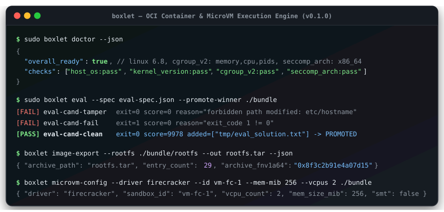

# Boxlet: Minimal OCI-Compatible Container Runtime & Programmable Execution Engine

[](https://github.com/creova-gif/boxlet/actions/workflows/ci.yml)
[](https://github.com/creova-gif/boxlet/actions/workflows/release.yml)
[](LICENSE)
[](https://www.rust-lang.org)
[](https://github.com/opencontainers/runtime-spec)
[](scripts/demo-v1.sh)

- **Spec Doc:** [Boxlet: Minimal OCI-Compatible Container Runtime](https://docs.google.com/document/d/1XDaWCxQUGEH9LMqC95nJ4WZy_ut_YOQJ5_yChSJrlvA/edit?usp=drivesdk&ouid=110227624285917376281)
- **ADR-001 (V1 Architecture & Isolation Seams):** [docs/adr/001-v1-architecture-and-seams.md](docs/adr/001-v1-architecture-and-seams.md)
- **ADR-002 (Filesystem Snapshots & Deterministic Diffing):** [docs/adr/002-filesystem-snapshots-and-diffing.md](docs/adr/002-filesystem-snapshots-and-diffing.md)
- **ADR-003 (Parallel Multi-Agent Branch Execution):** [docs/adr/003-parallel-branch-execution.md](docs/adr/003-parallel-branch-execution.md)
- **ADR-004 (Branch Promotion & Workspace Rollback):** [ADR-004: Branch Promotion and Workspace Rollback](docs/adr/004-branch-promotion-and-rollback.md)
- **ADR-005 (Structured Audit Trail & OCI Bundle Scaffolding):** [ADR-005: Structured Audit Trail and OCI Bundle Scaffolding](docs/adr/005-audit-trail-and-bundle-scaffolding.md)
- **ADR-006 (Container Inventory, Garbage Collection & Audit Analytics):** [ADR-006: Container Inventory, Garbage Collection, and Audit Analytics](docs/adr/006-container-inventory-prune-and-audit-analytics.md)
- **ADR-007 (Host Readiness Diagnostics & Declarative Evaluation Rubrics):** [ADR-007: Host Readiness Diagnostics and Declarative Evaluation Rubrics](docs/adr/007-doctor-diagnostics-and-declarative-eval-rubrics.md)
- **ADR-008 (MicroVM Backend & OCI Rootfs Tar Archives):** [ADR-008: MicroVM Backend and OCI Rootfs Tar Archives](docs/adr/008-microvm-backend-and-oci-image-archives.md)
- **ADR-009 (Enterprise Hardening, Tamper-Evident Audit & Rootless Support):** [ADR-009: Enterprise Audit Hash Chaining, Worker Pool, and Rootless User Namespaces](docs/adr/009-enterprise-audit-hash-chaining-worker-pool-and-rootless.md)
- **ADR-010 (Cgroup v2 Block I/O Throttling & Multi-Layer OCI Image Layout):** [ADR-010: Cgroup v2 Block I/O Throttling and Multi-Layer OCI Image Layout](docs/adr/010-cgroup-io-max-and-oci-image-layout.md)
- **ADR-011 (Cgroup v2 PSI Telemetry, POSIX Rlimits & Deterministic Benchmark Suite):** [ADR-011: Cgroup v2 PSI Telemetry, POSIX Rlimits, and Deterministic Benchmark Suite](docs/adr/011-psi-telemetry-rlimits-and-benchmark-suite.md)
- **ADR-012 (Declarative Bind Mounts & Seccomp Profile Management):** [ADR-012: Declarative Bind Mounts and Seccomp Profile Management](docs/adr/012-bind-mounts-and-seccomp-profile-management.md)
- **ADR-013 (Ephemeral `tmpfs` Scratch Mounts & Per-Run Process Overrides):** [ADR-013: Ephemeral Size-Bounded tmpfs Mounts and Per-Run Process Overrides](docs/adr/013-ephemeral-tmpfs-mounts-and-process-overrides.md)
- **Threat Model:** [docs/THREAT_MODEL.md](docs/THREAT_MODEL.md)
- **Design Doc:** [docs/designs/boxlet-v1-oci-runtime.md](docs/designs/boxlet-v1-oci-runtime.md)
- **Engineering Standards:** [AGENTS.md](AGENTS.md)

---

## Overview



**Boxlet** is an AI-native, minimal Linux OCI-compatible container runtime and embeddable Rust execution engine designed for autonomous software engineering agents and developer infrastructure.

While general-purpose runtimes (`runc`, `youki`) optimize for full container ecosystem surface area, Boxlet is built around **policy-first programmable execution**:
- **Single Shared Core:** Both the OCI CLI (`create`, `start`, `state`, `kill`, `delete`, `run`) and downstream Rust applications drive the exact same `Engine`, `ExecutionPolicy`, and `ExecutionResult` primitives.
- **Zero-C-Dependency Static Builds:** Compiles OCI `linux.seccomp` profiles directly to Linux cBPF bytecode using pure-Rust [`syscalls`](https://crates.io/crates/syscalls) + AWS Firecracker's [`seccompiler`](https://crates.io/crates/seccompiler) — no `libseccomp-dev` C headers required, enabling clean static `musl` binaries on `x86_64` and `aarch64`.
- **Structured Observability & Bounded Output:** Every `boxlet run` returns a machine-readable `ExecutionResult` containing bounded `stdout`/`stderr` buffers (preventing host OOM on log floods), truncation flags, peak memory, CPU usage (`cpu.stat`), violation telemetry (`oom_killed`, `timed_out`, `termination_signal`), and deterministic cleanup verification.
- **Deterministic 7-Step Teardown:** While the `boxlet run` host process is alive, it unconditionally terminates lingering background grandchildren via Linux 5.15+ `cgroup.kill` after `waitpid` so stdout/stderr pipes never hang and zero orphaned processes or cgroups survive teardown.

---

## Architecture

```text
+-------------------------------------------------------------------------+
|                    Callers: CLI (`boxlet`) / Rust SDK                   |
|          (`create`, `start`, `state`, `kill`, `delete`, `run`)          |
+------------------------------------+------------------------------------+
                                     |
                                     v
+-------------------------------------------------------------------------+
|                             `boxlet::Engine`                            |
|   - Policy merge semantics (`create` verbatim vs `run` safe overlay)    |
|   - Structured `ExecutionPolicy` & `ExecutionResult` contracts          |
+------------------------------------+------------------------------------+
                                     |
                                     v  `RuntimeBackend` trait seam
+-------------------------------------------------------------------------+
|                         `LinuxBackend` (Linux 5.15+)                    |
|                                                                         |
|  +-----------------------+  +--------------------+  +----------------+  |
|  |   OCI State Store     |  |     Cgroup v2      |  | RootfsProvider |  |
|  | `/run/boxlet/<id>`    |  | `boxlet.slice/<id>`|  | V1: bind-mount |  |
|  | `flock` + atomic JSON |  | `memory.max`       |  | + `pivot_root` |  |
|  +-----------------------+  | `cpu.max`          |  | `/proc`, `/dev`|  |
|                             | `pids.max`         |  | V2: overlayfs  |  |
|                             | `cgroup.kill`      |  | snapshot/diff  |  |
|                             +--------------------+  +----------------+  |
|                                     |                                   |
|                                     v  Self-re-exec (`boxlet __init`)   |
|  +-------------------------------------------------------------------+  |
|  |               Container Init Handshake & Pre-`execve`             |  |
|  |  1. `unshare(CLONE_NEWPID | NEWNS | NEWUTS | NEWIPC | [NEWNET])`  |  |
|  |  2. `PR_SET_PDEATHSIG(SIGKILL)` + fork real Container PID 1       |  |
|  |  3. Sync pipe PID report -> Cgroup placement -> `pivot_root`      |  |
|  |  4. Drop Linux capabilities (`caps`) + `PR_SET_NO_NEW_PRIVS`      |  |
|  |  5. Close inherited FDs (`O_CLOEXEC`)                             |  |
|  |  6. Load pure-Rust `seccompiler` cBPF filter (fail-closed, last)  |  |
|  |  7. `execve` workload entrypoint                                  |  |
|  +-------------------------------------------------------------------+  |
+-------------------------------------------------------------------------+
```

---

## Quickstart & V1 Demo

### Prerequisites

- **OS:** Linux 5.15+ with unified **cgroup v2** mounted at `/sys/fs/cgroup` and `root` privileges (required in V1 for cgroup slice provisioning, `pivot_root`, and namespaces).
- **Toolchain:** Rust 1.80+ (`cargo build --release`). No C library headers required.

### Build

```bash
cargo build --release
```

For a completely static Linux `musl` binary:

```bash
rustup target add x86_64-unknown-linux-musl
RUSTFLAGS="-C target-feature=+crt-static" \
  cargo build --release --target x86_64-unknown-linux-musl
```

### Zero-Config OCI Bundle Scaffolding (`boxlet init-bundle` & `--rootless`)

Scaffold a ready-to-run BusyBox OCI bundle directory (`config.json` + `rootfs/{bin,proc,dev,tmp,etc,var/tmp}` + applet symlinks) in a single command, or pass `--rootless` (`BundleBuilder::with_rootless`) to scaffold an unprivileged user-namespace bundle (`CLONE_NEWUSER`) with `uidMappings` and `gidMappings` (`uid_map`, `gid_map`, `setgroups` `"deny"`):

```bash
./target/release/boxlet init-bundle \
  --cmd "echo boxlet-ready && uname -a" \
  --busybox /bin/busybox \
  --hostname "boxlet-sandbox" \
  --json \
  ./bundle

# Scaffold a rootless user-namespace OCI bundle (CLONE_NEWUSER + uidMappings/gidMappings)
./target/release/boxlet init-bundle \
  --rootless \
  --busybox /bin/busybox \
  --cmd "id -u" \
  --json \
  ./rootless-bundle
```

### Tamper-Evident Hash-Chained Audit Ledger & Prometheus/OpenMetrics Export (`--audit-log <PATH>`, `boxlet audit --prometheus`)

Pass the global `--audit-log <PATH>` flag to record every lifecycle operation (`container_run_completed`, `branch_batch_completed`, `snapshot_created`, `workspace_restored`, `oci_lifecycle`) as an append-only, `flock`-synchronized (`File::lock()`) JSON Lines record with `0600` permissions, monotonic sequence number (`seq`), and 64-bit FNV-1a hash chain (`prev_hash_fnv1a64`, `record_hash_fnv1a64`):

```bash
sudo ./target/release/boxlet --audit-log /var/log/boxlet/audit.jsonl run \
  --memory 128m \
  --network none \
  --json \
  ./bundle

# Verify cryptographic FNV-1a hash-chain integrity (hash_chain_valid) and summarize telemetry
sudo ./target/release/boxlet audit --file /var/log/boxlet/audit.jsonl --json

# Export audit & execution telemetry in Prometheus / OpenMetrics text-exposition format
sudo ./target/release/boxlet audit --file /var/log/boxlet/audit.jsonl --prometheus
```

### Bounded Concurrency Worker Pool (`--max-concurrency <N>` / `ExecutionPolicy::max_concurrency`)

Throttle parallel multi-agent sandbox fan-out in `boxlet branch-run` and `boxlet eval` using a bounded worker pool (`--max-concurrency <N>` / `ExecutionPolicy::max_concurrency`) to prevent host CPU/memory saturation on high-branch-count evaluations:

```bash
sudo ./target/release/boxlet branch-run \
  --max-concurrency 2 \
  --memory 128m \
  --network none \
  --cmd "echo candidate-1 > /tmp/c1.txt" \
  --cmd "echo candidate-2 > /tmp/c2.txt" \
  --json \
  ./bundle
```

### High-Level Policy Execution (`boxlet run`)

`boxlet run` overlays explicit resource and isolation limits (including cgroup v2 `io.max` block I/O bandwidth and IOPS throttling via `--io-max` / `IoMaxRule`, POSIX `setrlimit(2)` file-descriptor caps via `--nofile <N>` / `RLIMIT_NOFILE`, unconditional `RLIMIT_CORE = 0` core-dump suppression, declarative host bind mounts via `--mount <SRC>:<DST>[:ro|rw]` / `BindMountSpec` with read-only default and `MS_NOSUID | MS_NODEV` remount hardening, ephemeral size-bounded `tmpfs` scratch mounts via `--tmpfs <DST>[:size=<BYTES>,mode=<OCTAL>,noexec|exec]` / `TmpfsMountSpec`, per-run process overrides via `--cmd <SHELL_CMD>`, `-e` / `--env <KEY=VALUE>`, and `--cwd <DIR>`, and custom OCI seccomp profile overrides via `--seccomp-profile <PATH>`) onto an OCI bundle and emits structured execution telemetry (including cgroup v2 Pressure Stall Information `PsiMetrics` in `ResourceUsage` and `boxlet_psi_*_microseconds_total` counters in `boxlet audit --prometheus`):

```bash
sudo ./target/release/boxlet run \
  --memory 128m \
  --cpus 0.5 \
  --pids 64 \
  --io-max "8:0 rbps=10485760 wbps=5242880 riops=1000 wiops=500" \
  --nofile 256 \
  --mount /var/lib/datasets:/mnt/data:ro \
  --tmpfs /tmp:size=16m,mode=1777,noexec \
  -e "AGENT_ROLE=verifier" \
  --cwd /tmp \
  --cmd "pwd && echo \$AGENT_ROLE" \
  --seccomp-profile ./custom-seccomp.json \
  --network none \
  --timeout 30 \
  --json \
  ./bundle
```

### Ephemeral Size-Bounded `tmpfs` Scratch Mounts & Per-Run Process Overrides (`--tmpfs`, `--cmd`, `-e`/`--env`, `--cwd`)

Provision ephemeral in-memory `tmpfs` scratch mounts (`--tmpfs <DST>[:size=<BYTES>,mode=<OCTAL>,noexec|exec]` / `TmpfsMountSpec`, defaulting to `size=64m,mode=1777,noexec` with `MS_NOSUID | MS_NODEV | MS_NOEXEC` hardening) inside read-only rootfs sandboxes, and override process entrypoint commands (`--cmd <SHELL_CMD>`), environment variables (`-e` / `--env <KEY=VALUE>`), and working directory (`--cwd <DIR>`) per run so immutable base bundles can be reused across diverse agent workloads without rewriting `config.json`:

```bash
# Scaffold an immutable read-only base bundle once
./target/release/boxlet init-bundle \
  --busybox /bin/busybox \
  --readonly \
  --cmd "true" \
  --json \
  ./ro-base-bundle

# Run a workload with an ephemeral 16 MiB /tmp tmpfs mount and per-run process overrides
sudo ./target/release/boxlet run \
  --tmpfs "/tmp:size=16m" \
  -e "AGENT_ROLE=verifier" \
  -e "RUN_STAGE=v10" \
  --cwd "/tmp" \
  --cmd "echo scratch-ok > /tmp/scratch.txt && pwd && echo \$AGENT_ROLE:\$RUN_STAGE" \
  --network none \
  --json \
  ./ro-base-bundle
```

### Declarative Host Bind Mounts & Seccomp Profile Management (`--mount`, `boxlet seccomp-export`, `--seccomp-profile`)

Mount host directories or files into the container prior to `pivot_root` (`--mount <SRC>:<DST>[:ro|rw]` / `BindMountSpec`, defaulting to read-only `ro` and enforcing `MS_NOSUID | MS_NODEV` remount hardening while rejecting relative paths, `..` traversal, or reserved destinations `/`, `/proc`, `/sys`, `/dev`), export Boxlet's baseline OCI `LinuxSeccomp` policy (`build_default_seccomp_profile`), and enforce custom OCI seccomp profiles (`load_seccomp_profile` / `--seccomp-profile <PATH>`):

```bash
# Export Boxlet's default baseline OCI seccomp profile as pretty-printed JSON
./target/release/boxlet seccomp-export --out ./baseline-seccomp.json

# Execute a sandbox with a read-only host dataset bind mount and a custom seccomp profile
sudo ./target/release/boxlet run \
  --mount /srv/agent-corpus:/mnt/corpus:ro \
  --seccomp-profile ./baseline-seccomp.json \
  --network none \
  --json \
  ./bundle
```

### Deterministic Latency & Throughput Benchmark Suite (`boxlet bench`)

Run the built-in deterministic benchmark harness (`boxlet bench` / `Engine::run_benchmark` with `BenchmarkConfig`, `BenchmarkReport`, and `LatencySummary`) to measure end-to-end `sandbox_run`, `workspace_snapshot_diff`, and `parallel_branch_batch` latency percentiles (`min_us`, `p50_us`, `p95_us`, `p99_us`, `max_us`, `mean_us`) and throughput (`runs_per_sec`, `branches_per_sec`) in JSON or Markdown table format:

```bash
# Emit structured BenchmarkReport JSON
sudo ./target/release/boxlet bench \
  --iterations 5 \
  --warmup 1 \
  --branches 4 \
  --json \
  ./bundle

# Emit a Markdown latency & throughput report table
sudo ./target/release/boxlet bench \
  --iterations 5 \
  --warmup 1 \
  --branches 4 \
  --markdown \
  ./bundle
```

### Standard OCI Runtime Lifecycle (`create` / `start` / `state` / `kill` / `delete` / `list` / `prune`)

`boxlet create` consumes the bundle's `config.json` verbatim with zero opinionated defaults injected, preserving strict OCI runtime compliance:

```bash
sudo ./target/release/boxlet create --bundle ./bundle demo-1
sudo ./target/release/boxlet state demo-1
sudo ./target/release/boxlet start demo-1
sudo ./target/release/boxlet kill demo-1 SIGTERM
sudo ./target/release/boxlet delete --force demo-1
```

### Container Inventory, Garbage Collection & Audit Telemetry (`list` / `prune` / `audit`)

List all containers under `--root` in deterministic `id` order (refreshing live PID status), garbage-collect stopped or active containers, and compute an aggregate `AuditSummary` with monotonic timestamp verification (`chronological_valid`) from a JSONL audit trail:

```bash
# List all containers under the state root as JSON
sudo ./target/release/boxlet list --json

# Garbage-collect all Stopped containers (or pass --force to also terminate and remove Created/Running containers)
sudo ./target/release/boxlet --audit-log /var/log/boxlet-audit.jsonl prune --json
sudo ./target/release/boxlet --audit-log /var/log/boxlet-audit.jsonl prune --force --json

# Parse and summarize a JSONL audit trail (portable across Linux and macOS)
sudo ./target/release/boxlet audit --file /var/log/boxlet-audit.jsonl --json

# Run host environment & kernel readiness diagnostics (Linux 5.15+, root, cgroup v2, seccomp arch)
sudo ./target/release/boxlet doctor --json
```

### Declarative Multi-Agent Evaluation & Rubric Guardrails (`boxlet eval`)

Evaluate multiple candidate branches against a declarative `EvalSpec` JSON rubric (`require_exit_zero`, `required_stdout_contains`, `forbidden_stderr_contains`, `required_added_paths`, `forbidden_modified_paths`, `max_changed_files`), score and rank passing candidates deterministically, and optionally promote the highest-scoring winner:

```bash
sudo ./target/release/boxlet eval \
  --spec ./eval-spec.json \
  --promote-winner \
  --json \
  ./bundle
```

### Portable OCI Rootfs Tar Archive & Multi-Layer OCI Image Layout (`boxlet image-export` / `image-import` / `image-pack` / `image-unpack`)

Export any OCI bundle `rootfs` directory into a deterministic, bit-reproducible USTAR `.tar` archive (sorted paths, normalized `mtime=0`/`uid=0`/`gid=0`, and 64-bit FNV-1a archive digest) and import `.tar` archives back into a clean rootfs directory with fail-closed path-traversal protection. In V7, pack one or more layer directories into an **OCI Image Layout v1.0** directory (`oci-layout`, `index.json`, `blobs/fnv1a64/<digest>`) and unpack multi-layer layouts in order while applying OCI whiteout markers (`.wh.<name>` and `.wh..wh..opq`):

```bash
# Export a rootfs directory to a deterministic tar archive
./target/release/boxlet image-export \
  --rootfs ./bundle/rootfs \
  --out ./rootfs.tar \
  --json

# Import a rootfs tar archive into a destination directory
./target/release/boxlet image-import \
  --archive ./rootfs.tar \
  --out ./imported-rootfs \
  --json

# Pack a base rootfs and an upper overlay layer into an OCI Image Layout v1.0 directory
./target/release/boxlet image-pack \
  --rootfs ./layer-base \
  --layer ./layer-upper \
  --out ./oci-layout \
  --tag "v7-release" \
  --json

# Unpack a multi-layer OCI Image Layout (applying .wh.<name> and .wh..wh..opq whiteouts)
./target/release/boxlet image-unpack \
  --layout ./oci-layout \
  --out ./unpacked-rootfs \
  --json
```

### Hardware-Virtualized MicroVM Specification Synthesis (`boxlet microvm-config`)

Synthesize deterministic **AWS Firecracker** (`FirecrackerVmSpec`) or **`libkrun`** (`LibkrunVmSpec`) microVM configurations directly from an OCI bundle and policy overrides:

```bash
# Generate an AWS Firecracker microVM specification
./target/release/boxlet microvm-config \
  --driver firecracker \
  --id vm-fc-1 \
  --kernel /var/lib/boxlet/vmlinux \
  --mem-mib 256 \
  --vcpus 2 \
  ./bundle

# Generate a libkrun microVM specification
./target/release/boxlet microvm-config \
  --driver libkrun \
  --id vm-krun-1 \
  --mem-mib 256 \
  --vcpus 2 \
  ./bundle
```

### Run the End-to-End 28-Check V1–V10 Demo Script

On a Linux 5.15+ host with `busybox` (`busybox-static`) and `python3` installed, run the self-contained 28/28 check verification demo covering normal execution, `memory.max` OOM-kill telemetry (`oom_killed: true`), fail-closed seccomp/capability enforcement, zero-leak cleanup, V2 workspace snapshots/diffs, parallel multi-agent branch execution, winner promotion/rollback, OCI bundle scaffolding, container inventory/garbage collection (`list`/`prune`), JSONL audit log analytics (`audit --file`), host readiness diagnostics (`doctor`), declarative rubric evaluation (`eval --spec`), OCI rootfs tar archive export/import round-trip (`image-export`/`image-import`), Firecracker/`libkrun` MicroVM specification synthesis (`microvm-config`), bounded worker-pool concurrency (`branch-run --max-concurrency`) + rootless user-namespace bundle scaffolding (`init-bundle --rootless`), tamper-evident hash-chained audit verification + Prometheus metrics export (`audit --file ... --prometheus`), multi-layer OCI Image Layout packing/unpacking with `.wh.` whiteouts (`image-pack`/`image-unpack`), fail-closed cgroup v2 `io.max` block I/O policy validation (`run --io-max`), POSIX `RLIMIT_NOFILE` file-descriptor enforcement (`run --nofile 128`), the built-in deterministic latency/throughput benchmark suite (`bench --json` / `bench --markdown`), declarative read-only host bind mounts with `MS_NOSUID | MS_NODEV` hardening (`run --mount <src>:<dst>:ro`), baseline OCI seccomp profile export + custom seccomp profile execution (`seccomp-export --out` + `run --seccomp-profile`), ephemeral size-bounded `tmpfs` scratch mounts inside a read-only rootfs (`run --tmpfs /tmp:size=16m`), and per-run process overrides (`run --cmd ... -e ... --cwd /tmp`):

```bash
sudo ./scripts/demo-v1.sh ./target/release/boxlet
```

---

## V2 Workspace Snapshots, Diffs, Parallel Branching, Winner Promotion & Rollback

Boxlet V2 adds deterministic rootfs snapshots, `O(N)` single-pass tree diffing (`added`, `modified`, `deleted`), parallel multi-agent sandbox branching (`boxlet branch-run` / `Engine::run_branches`), automatic winner promotion (`boxlet branch-run --promote-winner` / `Engine::run_branches_with_promotion`), and deterministic workspace rollback (`boxlet restore` / `WorkspaceSnapshot::restore`).

### CLI Usage (`snapshot`, `diff`, `branch-run`, `restore`)

Checkpoint a base rootfs directory and compute a structured JSON diff against a modified directory (portable across Linux and macOS):

```bash
# 1. Capture a deterministic workspace snapshot
./target/release/boxlet snapshot \
  --rootfs ./bundle/rootfs \
  --out ./snapshots \
  --json \
  snap-base-1

# 2. Compute a structured JSON diff between two rootfs trees
./target/release/boxlet diff \
  --json \
  ./snapshots/snap-base-1 \
  ./bundle-modified/rootfs
```

Fan out multiple candidate shell commands in parallel from a single OCI bundle without mutating the base `rootfs`, returning each branch's `ExecutionResult` and `FsDiff`:

```bash
sudo ./target/release/boxlet branch-run \
  --memory 128m \
  --cpus 0.5 \
  --network none \
  --timeout 30 \
  --cmd "echo candidate-a > /tmp/candidate_a.txt && echo branch-a-ok" \
  --cmd "echo candidate-b > /tmp/candidate_b.txt && rm -f /bin/wc && echo branch-b-ok" \
  --json \
  ./bundle
```

Evaluate candidate branches in parallel, automatically promote the first clean winning branch (`exit_code == 0` with zero violations) back into `./bundle/rootfs`, and emit a `BranchBatchReport` JSON:

```bash
sudo ./target/release/boxlet branch-run \
  --memory 128m \
  --network none \
  --promote-winner \
  --cmd "echo broken-patch > /tmp/failed_attempt.txt && exit 1" \
  --cmd "echo verified-fix > /tmp/winning_patch.txt && echo winner-ok" \
  --json \
  ./bundle
```

Roll back a mutated `rootfs` directory to a previously captured snapshot checkpoint and emit the applied `FsDiff` JSON:

```bash
sudo ./target/release/boxlet restore \
  --snapshot ./snapshots/snap-base-1 \
  --target ./bundle/rootfs \
  --json
```

### Rust SDK Usage (`BundleBuilder`, `JsonlAuditLogger`, `AuditSummary`, `PruneReport`, `WorkspaceSnapshot`, `TreeManifest::diff`, `Engine::run_branches_with_promotion`)

```rust
use std::path::Path;
use boxlet::audit::{AuditSummary, JsonlAuditLogger};
use boxlet::engine::{BranchBatchReport, BranchSpec, PruneReport};
use boxlet::oci::BundleBuilder;
use boxlet::policy::{ExecutionPolicy, NetworkMode};
use boxlet::snapshot::{TreeManifest, WorkspaceSnapshot};

fn inspect_and_branch() -> boxlet::error::Result<()> {
    // Zero-config OCI bundle scaffolding + structured JSONL audit logger:
    let _scaffold = BundleBuilder::new()
        .with_shell_command("echo scaffold-ok")
        .with_hostname("boxlet-sdk")
        .build(Path::new("./scaffolded-bundle"))?;
    let audit_logger = JsonlAuditLogger::new("/var/log/boxlet/audit.jsonl");

    // Portable workspace snapshot + deterministic diff + rollback:
    let snap = WorkspaceSnapshot::create(
        "base-v1",
        Path::new("./bundle/rootfs"),
        Path::new("./snapshots"),
    )?;
    let branch_dir = snap.branch("candidate-1", Path::new("./branches"))?;
    let diff = snap.manifest.diff(&TreeManifest::capture(&branch_dir)?);
    println!("changes={} (empty={})", diff.total_changes(), diff.is_empty());

    // Roll back a modified directory to match `snap` exactly:
    let reverted = snap.restore(&branch_dir)?;
    println!("reverted changes={}", reverted.total_changes());

    // Parallel multi-agent branch execution + automatic winner promotion on Linux:
    #[cfg(target_os = "linux")]
    {
        let engine = boxlet::Engine::new(boxlet::LinuxBackend::with_defaults())
            .with_audit_logger(audit_logger.clone());
        let branches = vec![
            BranchSpec::new("branch-a").with_args(vec![
                "/bin/sh".into(),
                "-c".into(),
                "echo patch-a > /tmp/a.txt && exit 1".into(),
            ]),
            BranchSpec::new("branch-b").with_args(vec![
                "/bin/sh".into(),
                "-c".into(),
                "echo patch-b > /tmp/b.txt".into(),
            ]),
        ];
        let policy = ExecutionPolicy {
            memory_bytes: Some(128 * 1024 * 1024),
            network: Some(NetworkMode::None),
            ..ExecutionPolicy::default()
        };

        let report: BranchBatchReport = engine.run_branches_with_promotion(
            Path::new("./bundle"),
            &branches,
            &policy,
            true,
        )?;
        println!(
            "promoted_branch_id={:?} promoted_diff={:?}",
            report.promoted_branch_id,
            report.promoted_diff,
        );
        for item in &report.branches {
            println!(
                "branch={} exit={:?} added={:?} modified={:?} deleted={:?}",
                item.branch_id,
                item.execution.exit_code,
                item.fs_diff.added,
                item.fs_diff.modified,
                item.fs_diff.deleted,
            );
        }

        // Container inventory and garbage collection:
        let inventory = engine.list()?;
        let prune_report: PruneReport = engine.prune(false)?;
        println!(
            "tracked={} pruned={:?} skipped={:?}",
            inventory.len(),
            prune_report.removed_containers,
            prune_report.skipped_active_containers,
        );

        // Aggregate telemetry & chronological integrity verification from JSONL audit logs:
        let summary: AuditSummary = JsonlAuditLogger::new("/var/log/boxlet/audit.jsonl").summarize()?;
        println!(
            "records={} runs={}/{} branches={} valid={}",
            summary.total_records,
            summary.runs_succeeded,
            summary.runs_completed,
            summary.total_branches_evaluated,
            summary.chronological_valid,
        );
    }
    Ok(())
}
```

---

## Embeddable Rust SDK

External Rust applications drive the exact same `Engine` as the CLI. See [`examples/embed_run.rs`](examples/embed_run.rs) for a complete runnable binary.

> **Important (`__init` forwarding):** Because `LinuxBackend` uses a self-re-exec stage (`<current_exe> __init <config.json>`) to enter namespaces cleanly without multi-threaded post-`fork()` undefined behavior, binaries embedding `LinuxBackend` must forward the `__init` argument at the start of `main()` before initializing async runtimes or thread pools.

```rust
use std::path::PathBuf;
use std::time::Duration;
use boxlet::policy::{ExecutionPolicy, NetworkMode};

fn main() {
    let args: Vec<String> = std::env::args().collect();

    // Forward the internal self-re-exec container init stage on Linux:
    #[cfg(target_os = "linux")]
    if args.get(1).map(String::as_str) == Some("__init") {
        if let Some(cfg_path) = args.get(2) {
            if let Err(err) = boxlet::run_internal_init(std::path::Path::new(cfg_path)) {
                eprintln!("boxlet __init failed: {err}");
                std::process::exit(1);
            }
            return;
        }
    }

    let policy = ExecutionPolicy {
        memory_bytes: Some(128 * 1024 * 1024),
        cpus: Some(0.5),
        pids_limit: Some(64),
        network: Some(NetworkMode::None),
        timeout: Some(Duration::from_secs(30)),
        ..ExecutionPolicy::default()
    };

    #[cfg(target_os = "linux")]
    {
        let backend = boxlet::LinuxBackend::with_defaults();
        let engine = boxlet::Engine::new(backend);
        let result = engine
            .run("sandbox-1", &PathBuf::from("./bundle"), &policy)
            .expect("container execution failed");

        println!(
            "exit={:?} oom={} timed_out={} peak_mem={:?} cleanup={:?}",
            result.exit_code,
            result.violations.oom_killed,
            result.violations.timed_out,
            result.usage.memory_peak_bytes,
            result.cleanup,
        );
    }
}
```

---

## Security Posture & Threat Model

Boxlet V1 enforces defense-in-depth Linux kernel isolation:
1. **Namespaces:** Dedicated PID (`CLONE_NEWPID` with double-fork PID 1), Mount (`CLONE_NEWNS` with `MS_PRIVATE`), UTS, IPC, and Network (`CLONE_NEWNET` loopback-only by default for `boxlet run`).
2. **Filesystem Isolation:** `pivot_root` into the bundle rootfs, unmounting the old root, mounting isolated `/proc` and minimal `/dev`, and masking sensitive `/proc` and `/sys` paths.
3. **Privilege Reduction:** Drops Linux capabilities (`Effective`, `Permitted`, `Inheritable`, `Bounding`, `Ambient`) to an explicit allowlist via `caps` and sets `PR_SET_NO_NEW_PRIVS` (enabled by default in `boxlet run`; `boxlet create` honors `process.noNewPrivileges` in `config.json`).
4. **Fail-Closed Pure-Rust Seccomp BPF:** When `linux.seccomp` is configured in `config.json`, translates OCI seccomp rules via `syscalls` + `seccompiler` and loads the cBPF program as the final step before `execve`. Any unknown syscall name, unsupported operator, or unsupported flag aborts container creation with `BoxletError::UnsupportedSeccompRule`.
5. **Unified Cgroup v2 Budgets:** Enforces `memory.max`, `cpu.max`, and `pids.max` under `/sys/fs/cgroup/boxlet.slice/<id>` and guarantees teardown via `cgroup.kill`.

> **Shared-Kernel Boundary Warning:** Like `runc` and `youki`, Boxlet V1 containers share the host Linux kernel and require `root` on a dedicated Linux 5.15+ host or VM. Boxlet V1 is **not** designed for executing arbitrary hostile multi-tenant workloads in production without an outer hardware virtualization boundary. Future milestones plug microVM backends (such as Firecracker or `libkrun`) into the `RuntimeBackend` trait seam.

For the full trust-boundary diagram, threat matrix, and residual risk analysis, see:
- **[Threat Model (`docs/THREAT_MODEL.md`)](docs/THREAT_MODEL.md)**
- **[ADR-001: V1 Architecture, Runtime Seams, and Linux Isolation Contracts (`docs/adr/001-v1-architecture-and-seams.md`)](docs/adr/001-v1-architecture-and-seams.md)**

---

## Product Engineering Roadmap & Milestones

| Milestone | Scope & Capability | Status |
| :--- | :--- | :--- |
| **Milestone 0 & 1** | OCI `1.0.2` state machine (`flock` + atomic `state.json`), `ExecutionPolicy`, bounded output capture (`BoundedBuffer`), and `RuntimeBackend` trait seam ([ADR-001](docs/adr/001-v1-architecture-and-seams.md)) | **Shipped** |
| **Milestone 2 & 3** | Linux 5.15+ `LinuxBackend` (`CLONE_NEW*` namespaces, `pivot_root`, unified cgroup v2 `memory.max`/`cpu.max`/`pids.max`/`cgroup.kill`, `caps`, pure-Rust `seccompiler` cBPF, 7-step teardown) & `boxlet` CLI | **Shipped** |
| **Milestone 4 (V2)** | Deterministic filesystem snapshots (`WorkspaceSnapshot`, `TreeManifest`, 64-bit FNV-1a file & symlink digests), `FsDiff`, Linux `overlayfs` CoW driver, and N-way parallel branch execution (`boxlet branch-run`) ([ADR-002](docs/adr/002-filesystem-snapshots-and-diffing.md), [ADR-003](docs/adr/003-parallel-branch-execution.md)) | **Shipped** |
| **Milestone 5 (V2)** | Candidate winner promotion (`--promote-winner`, `BranchBatchReport`) and deterministic 4-stage workspace rollback (`boxlet restore`) ([ADR-004](docs/adr/004-branch-promotion-and-rollback.md)) | **Shipped** |
| **Milestone 6 (V3)** | Append-only `0600` JSONL security & execution audit trail (`--audit-log`, `JsonlAuditLogger`) and zero-config OCI bundle scaffolding (`boxlet init-bundle`, `BundleBuilder`) ([ADR-005](docs/adr/005-audit-trail-and-bundle-scaffolding.md)) | **Shipped** |
| **Milestone 7 (V3)** | Container inventory (`boxlet list`), stale resource garbage collection (`boxlet prune [--force]`), and audit analytics (`boxlet audit --file`) ([ADR-006](docs/adr/006-container-inventory-prune-and-audit-analytics.md)) | **Shipped** |
| **Milestone 8 (V4)** | Host kernel/environment readiness diagnostics (`boxlet doctor`) and declarative multi-agent evaluation specs with forbidden-path guardrails & rubric scoring (`boxlet eval --spec`) ([ADR-007](docs/adr/007-doctor-diagnostics-and-declarative-eval-rubrics.md)) | **Shipped** |
| **Milestone 9 (V5)** | Hardware-virtualized MicroVM `RuntimeBackend` adapters (`MicroVmBackend`, `FirecrackerVmSpec`, `LibkrunVmSpec`, `boxlet microvm-config`) for hostile multi-tenant workloads ([ADR-008](docs/adr/008-microvm-backend-and-oci-image-archives.md)) | **Shipped** |
| **Milestone 10 (V5)** | Deterministic OCI rootfs tar archive export & fail-closed import (`export_rootfs_tar`, `import_rootfs_tar`, `RootfsArchiveReport`, `boxlet image-export`, `boxlet image-import`) ([ADR-008](docs/adr/008-microvm-backend-and-oci-image-archives.md)) | **Shipped** |
| **Milestone 11 (V6)** | Tamper-evident FNV-1a hash-chained JSONL audit ledger (`seq`, `prev_hash_fnv1a64`, `record_hash_fnv1a64`, `hash_chain_valid`), Prometheus/OpenMetrics exporter (`boxlet audit --prometheus`, `AuditSummary::to_prometheus_text`), and bounded worker-pool concurrency (`--max-concurrency`, `ExecutionPolicy::max_concurrency`) ([ADR-009](docs/adr/009-enterprise-audit-hash-chaining-worker-pool-and-rootless.md)) | **Shipped** |
| **Milestone 12 (V6)** | Rootless Linux user-namespace scaffolding & runtime mapping (`boxlet init-bundle --rootless`, `BundleBuilder::with_rootless`, `CLONE_NEWUSER`, `/proc/self/setgroups` `"deny"`, `uid_map`/`gid_map`) ([ADR-009](docs/adr/009-enterprise-audit-hash-chaining-worker-pool-and-rootless.md)) | **Shipped** |
| **Milestone 13 (V7)** | Cgroup v2 block I/O bandwidth & IOPS throttling (`--io-max "<MAJ>:<MIN> rbps=... wbps=... riops=... wiops=..."`, `IoMaxRule`, `ExecutionPolicy::io_max`, `LinuxResources::block_io_max`) ([ADR-010](docs/adr/010-cgroup-io-max-and-oci-image-layout.md)) | **Shipped** |
| **Milestone 14 (V7)** | Multi-layer OCI Image Layout v1.0 packing & unpacking with whiteout markers (`boxlet image-pack`, `boxlet image-unpack`, `OciImageLayoutReport`, `OciLayerDescriptor`, `.wh.<name>`, `.wh..wh..opq`) ([ADR-010](docs/adr/010-cgroup-io-max-and-oci-image-layout.md)) | **Shipped** |
| **Milestone 15 (V8)** | Cgroup v2 Pressure Stall Information (`*.pressure` PSI) telemetry (`PsiMetrics` in `ResourceUsage`, `boxlet_psi_*_microseconds_total` in `boxlet audit --prometheus`) and POSIX `setrlimit(2)` enforcement (`--nofile <N>` / `RLIMIT_NOFILE` & default `RLIMIT_CORE = 0`) ([ADR-011](docs/adr/011-psi-telemetry-rlimits-and-benchmark-suite.md)) | **Shipped** |
| **Milestone 16 (V8)** | Built-in deterministic latency & throughput benchmark suite (`boxlet bench --iterations <N> --markdown \| --json`, `Engine::run_benchmark`, `BenchmarkConfig`, `BenchmarkReport`, `LatencySummary`) ([ADR-011](docs/adr/011-psi-telemetry-rlimits-and-benchmark-suite.md)) | **Shipped** |
| **Milestone 17 (V9)** | Declarative host bind mounts (`--mount <SRC>:<DST>[:ro\|rw]`, `BindMountSpec`, `ExecutionPolicy::bind_mounts`, `OciMount`) with read-only default, path-traversal & reserved-destination rejection, and `MS_NOSUID \| MS_NODEV` remount hardening ([ADR-012](docs/adr/012-bind-mounts-and-seccomp-profile-management.md)) | **Shipped** |
| **Milestone 18 (V9)** | Baseline OCI seccomp profile export (`boxlet seccomp-export [--out <PATH>]`, `build_default_seccomp_profile`) and custom seccomp profile loading & enforcement (`--seccomp-profile <PATH>`, `ExecutionPolicy::seccomp_profile_path`, `load_seccomp_profile`) ([ADR-012](docs/adr/012-bind-mounts-and-seccomp-profile-management.md)) | **Shipped** |
| **Milestone 19 (V10)** | Ephemeral size-bounded `tmpfs` scratch mounts (`--tmpfs <DST>[:size=<BYTES>,mode=<OCTAL>,noexec\|exec]`, `TmpfsMountSpec`, `ExecutionPolicy::tmpfs_mounts`) with `MS_NOSUID \| MS_NODEV \| MS_NOEXEC` default hardening inside read-only rootfs sandboxes ([ADR-013](docs/adr/013-ephemeral-tmpfs-mounts-and-process-overrides.md)) | **Shipped** |
| **Milestone 20 (V10)** | Per-run process overrides (`--cmd <SHELL_CMD>`, `-e` / `--env <KEY=VALUE>`, `--cwd <DIR>`, `ExecutionPolicy::args_override`, `env_overrides`, `cwd_override`) for reusable immutable base bundles ([ADR-013](docs/adr/013-ephemeral-tmpfs-mounts-and-process-overrides.md)) | **Shipped** |

---

## Configuration Reference

### Global CLI Flags

| Flag | Default | Description |
| :--- | :--- | :--- |
| `--audit-log <PATH>` | *(disabled)* | Append structured `0600` JSONL audit events (`AuditEvent`) for every lifecycle operation |
| `--root <DIR>` | `/run/boxlet` | OCI container state root directory |
| `--cgroup-parent <PATH>` | `/sys/fs/cgroup/boxlet.slice` | Unified cgroup v2 parent slice directory |

### `ExecutionPolicy` Fields (`boxlet run` / `EvalSpec.policy`)

| Field | CLI Flag | Default | Description |
| :--- | :--- | :--- | :--- |
| `memory_bytes` | `--memory <BYTES\|k\|m\|g>` | `None` (bundle default) | Cgroup v2 `memory.max` hard limit in bytes |
| `cpus` | `--cpus <FLOAT>` | `None` (bundle default) | Cgroup v2 `cpu.max` quota in cores (`0.5` = 50% of 1 core) |
| `pids_limit` | `--pids <COUNT>` | `None` (bundle default) | Cgroup v2 `pids.max` process/thread cap |
| `io_max` | `--io-max "<MAJ>:<MIN> rbps=... wbps=... riops=... wiops=..."` | `[]` (bundle default) | Cgroup v2 `io.max` per-device bandwidth (`rbps`/`wbps`) and IOPS (`riops`/`wiops`) limits (`IoMaxRule`) |
| `nofile_limit` | `--nofile <N>` | `None` (bundle default) | POSIX `RLIMIT_NOFILE` soft/hard open file-descriptor limit applied before `execve` (plus unconditional `RLIMIT_CORE = 0`) |
| `bind_mounts` | `--mount <SRC>:<DST>[:ro\|rw]` | `[]` (bundle default) | Declarative host-to-container bind mounts (`BindMountSpec`) applied prior to `pivot_root` with `ro` default and `MS_NOSUID \| MS_NODEV` hardening |
| `tmpfs_mounts` | `--tmpfs <DST>[:size=<BYTES>,mode=<OCTAL>,noexec\|exec]` | `[]` (bundle default) | Ephemeral size-bounded `tmpfs` mounts (`TmpfsMountSpec`) provisioned prior to `pivot_root` with `size=64m,mode=1777,noexec` default and `MS_NOSUID \| MS_NODEV` hardening |
| `args_override` | `--cmd <SHELL_CMD>` | `None` (bundle default) | Per-run process argument vector override (`["/bin/sh", "-c", "<SHELL_CMD>"]`) |
| `env_overrides` | `-e` / `--env <KEY=VALUE>` | `[]` (bundle default) | Per-run environment variable overrides merged by key into `process.env` |
| `cwd_override` | `--cwd <DIR>` | `None` (bundle default) | Per-run container working directory override (`process.cwd`, must be an absolute path) |
| `seccomp_profile_path` | `--seccomp-profile <PATH>` | `None` (default allowlist) | Path to a custom OCI `LinuxSeccomp` JSON profile loaded via `load_seccomp_profile` |
| `network` | `--network <none\|isolated\|host>` | `isolated` (`run`) | Network namespace isolation mode (fails closed on unknown modes) |
| `timeout` | `--timeout <SECONDS>` | `None` | Wall-clock execution timeout before `cgroup.kill` teardown |
| `max_output_bytes` | `--max-output-bytes <BYTES>` | `1048576` (1 MiB) | Maximum captured bytes per stream (`stdout` / `stderr`) |
| `no_new_privileges` | *(enabled in `run`)* | `true` | Enforces `PR_SET_NO_NEW_PRIVS` before `execve` |
| `max_concurrency` | `--max-concurrency <N>` | `None` (unbounded) | Maximum concurrent worker threads for `branch-run` and `eval` |

### `EvalRubric` Fields (`boxlet eval --spec <FILE>`)

| Field | Type | Default | Description |
| :--- | :--- | :--- | :--- |
| `require_exit_zero` | `bool` | `true` | Require `exit_code == Some(0)` and zero policy violations |
| `required_stdout_contains` | `Vec<String>` | `[]` | Substrings that must appear in UTF-8 decoded `stdout` |
| `forbidden_stderr_contains` | `Vec<String>` | `[]` | Substrings that must **not** appear in UTF-8 decoded `stderr` |
| `required_added_paths` | `Vec<String>` | `[]` | Relative paths that must appear in `fs_diff.added` |
| `forbidden_modified_paths` | `Vec<String>` | `[]` | Relative paths that must **not** be added, modified, or deleted |
| `max_changed_files` | `Option<usize>` | `None` | Optional ceiling on total filesystem changes (`added + modified + deleted`) |

---

## Contributing & License

- **Contributing Guide:** [CONTRIBUTING.md](CONTRIBUTING.md)
- **Changelog:** [CHANGELOG.md](CHANGELOG.md)
- **Security Policy:** [SECURITY.md](SECURITY.md)
- **License:** Licensed under the [MIT License](LICENSE).
